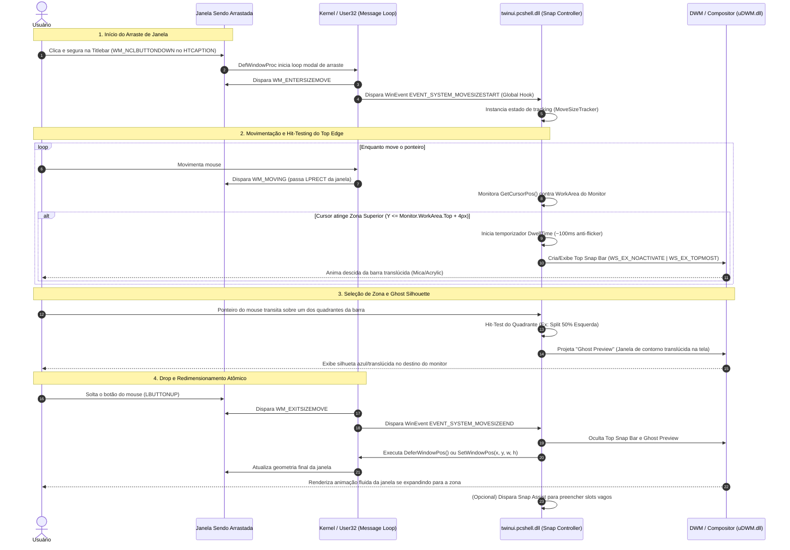

# Especificação Técnica de Engenharia Reversa (REA): Snap Layouts & Top Snap Bar (Windows 11) e Guia Arquitetural para Cinnamon (Linux Mint)

Este documento consolida a análise técnica e de engenharia reversa do subsistema de **Snap Layouts / Top Snap Bar / Aero Snap** do Windows 11, detalhando as estruturas nativas Win32/DWM, o ciclo de mensagens de movimentação, o modelo de hit-testing de tela e a renderização do overlay. Em seguida, estabelece o mapeamento arquitetural completo (*De-Para*) para o desenvolvimento de uma extensão equivalente no compositor **Muffin / Clutter (CJS)** do **Linux Mint (Cinnamon)**.

---

## 1. Mapeamento de Binários e Subsistemas do Windows

| Camada | Binário / Módulo | Papel Arquitetural e Responsabilidade |
| :--- | :--- | :--- |
| **Compositor Gráfico** | `C:\Windows\System32\uDWM.dll` / `dwm.exe` | *Desktop Window Manager*. Gerencia superfícies de composição em hardware (DirectComposition/DirectX), thumbnails em tempo real (`DwmRegisterThumbnail`), efeitos de translucidez de sistema (Mica, Mica Alt, Acrylic via `DwmSetWindowAttribute`) e transições geométricas animadas. |
| **Shell Multitasking** | `C:\Windows\System32\twinui.pcshell.dll` | *Composable Shell ShellCore*. Contém os controladores `SnapFlyout`, `SnapLayoutBar`, `WindowArranger` e `MultitaskingManager`. Orquestra a exibição do menu de layouts ao pairar sobre o botão Maximizar (`HTMAXBUTTON`) ou ao arrastar até o topo da tela. |
| **Kernel / Win32k** | `C:\Windows\System32\win32kbase.sys` / `win32kfull.sys` | Subsistema de janelas do kernel. Intercepta eventos de mouse em modo protegido, gerencia o tracking de arrasto de janelas (`DefWindowProcW`), envia as mensagens `WM_ENTERSIZEMOVE`, `WM_MOVING`, `WM_EXITSIZEMOVE` e provê o suporte a ganchos de eventos de acessibilidade (`SetWinEventHook`). |
| **Window Manager API** | `C:\Windows\System32\user32.dll` | Biblioteca de espaço de usuário para APIs de posicionamento atômico (`SetWindowPos`, `BeginDeferWindowPos`, `DeferWindowPos`, `EndDeferWindowPos`), queries de monitor (`GetMonitorInfoW`, `MonitorFromPoint`) e hit-testing (`GetCursorPos`). |
| **UI Framework Moderno** | `C:\Windows\SystemApps\MicrosoftWindows.Client.CBS_*\Windows.UI.Xaml.dll` | Renderiza a interface vetorial e cartões de layout da barra suspensa (Snap Bar) e dos flyouts usando XAML Islands / WinUI com aceleração DirectComposition. |

---

## 2. Diagrama de Sequência de Engenharia Reversa (Windows Win32 + DWM)

O fluxo abaixo descreve o ciclo de vida exato do arraste de janela, hit-testing da borda superior, exibição da barra translúcida e redimensionamento final:



---

## 3. Análise Detalhada dos Mecanismos Win32 e DWM

### 3.1 O Loop Modal de Movimentação do Win32
Quando um aplicativo recebe um clique na barra de título (`HTCAPTION`), a chamada padrão `DefWindowProcW` intercepta o evento e assume o controle da fila de mensagens através de um loop modal bloqueante:
1. **`WM_ENTERSIZEMOVE` (0x0231):** Enviado à janela uma única vez no momento em que o usuário começa o arraste ou redimensionamento.
2. **`WM_MOVING` (0x0216):** Enviado continuamente enquanto a janela é movida. O parâmetro `lParam` contém um ponteiro para a estrutura `RECT` com as coordenadas de tela da janela.
3. **`WM_EXITSIZEMOVE` (0x0232):** Enviado uma única vez quando o usuário solta o botão do mouse ou cancela a operação (tecla ESC).

> [!IMPORTANT]
> **Como o Shell do Windows detecta o arraste sem injetar DLLs em todas as janelas:**  
> O `twinui.pcshell.dll` não intercepta o `WM_MOVING` diretamente da janela do cliente. Ele registra um gancho global de acessibilidade via Win32:
> ```cpp
> HWINEVENTHOOK hHook = SetWinEventHook(
>     EVENT_SYSTEM_MOVESIZESTART, // 0x000A
>     EVENT_SYSTEM_MOVESIZEEND,   // 0x000B
>     NULL,
>     &WinEventProcCallback,
>     0, 0,
>     WINEVENT_OUTOFCONTEXT | WINEVENT_SKIPOWNPROCESS
> );
> ```
> Isso permite que o subsistema seja notificado de qualquer movimentação iniciada no sistema operacional de forma isolada e segura.

### 3.2 Hit-Testing e Heurística da Borda Superior (Top Snap Bar)
O Windows divide o monitor em áreas lógicas obtidas via `GetMonitorInfoW` (`rcMonitor` vs `rcWork`):
* **Margem Gatilho:** Quando o ponteiro global atinge uma coordenada `cursor.y <= rcWork.top + THRESHOLD` (onde `THRESHOLD` varia entre 2 a 6 pixels).
* **Filtro de Dwell Time:** Para evitar que a barra desça acidentalmente durante movimentos rápidos diagonais de mouse, o Shell impõe um temporizador de latência (~80 a 150 ms) ou uma verificação de velocidade vetorial (`velocity.y <= 0` e desaceleração).

### 3.3 A Janela Overlay (Snap Bar)
A Top Snap Bar possui flags de janela específicas para garantir que o usuário continue interagindo com a janela que está sendo arrastada sem perder a captura de entrada (*mouse capture*):
* **Estilos de Janela:**
  * `WS_POPUP`: Janela sem molduras ou decorações de sistema.
  * `WS_EX_TOOLWINDOW`: Não cria ícone na barra de tarefas nem aparece no seletor Alt + Tab.
  * `WS_EX_TOPMOST`: Permanece sobreposta a todas as janelas convencionais na Z-Order.
  * `WS_EX_NOACTIVATE`: **Crítico**. Impede que o clique ou hover ative a barra, garantindo que o foco e o ponteiro continuem pertencendo à janela de origem.
* **Efeito Visual (Mica / Acrylic):**
  * Configurado via API nativa do Desktop Window Manager:
    ```cpp
    DWORD backdropType = DWMSBT_TRANSIENTWINDOW; // Acrylic no Windows 11 22H2+
    DwmSetWindowAttribute(hWndOverlay, DWMWA_SYSTEMBACKDROP_TYPE, &backdropType, sizeof(backdropType));
    ```

### 3.4 Aplicação Atômica de Geometria
Ao soltar a janela (`EVENT_SYSTEM_MOVESIZEEND` / `WM_EXITSIZEMOVE`) sobre uma zona válida:
1. O Shell calcula as dimensões absolutas do quadrante baseado em `rcWork` (ex: metade esquerda = `[left = 0, top = 0, width = workWidth / 2, height = workHeight]`).
2. Executa a reorganização via `DeferWindowPos`:
   ```cpp
   HDWP hdwp = BeginDeferWindowPos(1);
   hdwp = DeferWindowPos(hdwp, hWndTarget, HWND_TOP, 
                         targetRect.left, targetRect.top, 
                         targetRect.right - targetRect.left, 
                         targetRect.bottom - targetRect.top, 
                         SWP_NOZORDER | SWP_NOACTIVATE | SWP_FRAMECHANGED);
   EndDeferWindowPos(hdwp);
   ```

---

## 4. Arquitetura do Compositor do Linux Mint (Cinnamon / Muffin)

No Linux Mint com ambiente de desktop Cinnamon, a arquitetura é baseada em:
* **Muffin:** O gerenciador de janelas e compositor (fork do Mutter / Clutter).
* **CJS (Cinnamon JavaScript):** O motor de scripting (baseado em GJS / SpiderMonkey da Mozilla) que orquestra a Shell do Cinnamon e suas extensões.
* **Clutter & Cogl:** Bibliotecas gráficas para árvore de nós de cena (Actors) e backend acelerado por hardware OpenGL/GLES.
* **St (Shell Toolkit):** Conjunto de widgets estilizados via CSS usados pelos applets, desklets e extensões do Cinnamon.

```
+-------------------------------------------------------------------------+
|                  CINNAMON SHELL EXTENSION (CJS)                         |
|   - Escuta sinais do MetaDisplay / MetaWindow                           |
|   - Cria St.Widget / Clutter.Actor na Top Layer (Main.uiGroup)          |
|   - Realiza Hit-Testing do cursor e gerencia animações Clutter          |
+-------------------------------------------------------------------------+
                                    |
                                    v
+-------------------------------------------------------------------------+
|                    MUFFIN COMPOSITOR (C / GLib)                         |
|   - MetaDisplay (Loop de eventos X11/Wayland)                           |
|   - MetaWindow (Representação de cada janela de cliente)                |
|   - MetaGrabOp (Enumeração de operações de arraste / resize)            |
+-------------------------------------------------------------------------+
                                    |
                                    v
+-------------------------------------------------------------------------+
|                     CLUTTER / COGL / OPENGL                             |
|   - Composição de superfícies e pipelines gráficos                      |
|   - Clutter.Stage (Raiz da interface)                                   |
+-------------------------------------------------------------------------+
```

---

## 5. Tabela De-Para: Windows Win32 vs Cinnamon Muffin

| Conceito / Função | Windows 11 (Win32 / DWM) | Cinnamon / Linux Mint (Muffin / CJS) |
| :--- | :--- | :--- |
| **Início de Arraste** | `WM_ENTERSIZEMOVE` / `EVENT_SYSTEM_MOVESIZESTART` | `global.display.connect('grab-op-begin', (display, screen, window, op) => ...)` onde `op === Meta.GrabOp.MOVING` |
| **Durante o Arraste** | `WM_MOVING` ou `GetCursorPos()` em loop de hook | `global.stage.connect('captured-event', ...)` escutando `Clutter.EventType.MOTION` |
| **Fim do Arraste (Drop)** | `WM_EXITSIZEMOVE` / `EVENT_SYSTEM_MOVESIZEEND` | `global.display.connect('grab-op-end', (display, screen, window, op) => ...)` |
| **Área do Monitor (WorkArea)**| `GetMonitorInfoW(hMon, &mi)` -> `mi.rcWork` | `Main.layoutManager.monitors[index]` ou `window.get_work_area_current_monitor()` |
| **Janela Overlay (Snap Bar)**| `CreateWindowEx(WS_EX_TOPMOST \| WS_EX_NOACTIVATE)` | Novo `St.BoxLayout` / `St.Widget` adicionado a `Main.uiGroup` (camada superior da UI) |
| **Estética Translúcida** | `DwmSetWindowAttribute(DWMWA_SYSTEMBACKDROP_TYPE)` (Mica/Acrylic) | Estilização CSS com `rgba(...)`, `border-radius`, sombras e `box-shadow` no `stylesheet.css` da extensão |
| **Ghost Preview (Silhueta)** | Janela flutuante com cor de acento do DWM | `Meta.FeedbackActor` ou ator `St.Bin` semi-transparente cobrindo a zona alvo |
| **Redimensionar Janela** | `SetWindowPos()` / `DeferWindowPos()` | `window.unmaximize(Meta.MaximizeFlags.BOTH);` seguido de `window.move_resize_frame(true, x, y, width, height)` |

---

## 6. Especificação para Implementação da Extensão no Cinnamon

### 6.1 Estrutura de Arquivos da Extensão
O Cinnamon carrega extensões localizadas em `~/.local/share/cinnamon/extensions/<uuid>/`:

```
~/.local/share/cinnamon/extensions/snap-layouts@pedro/
├── metadata.json       # Manifesto com UUID, nome, descrição e versão do Cinnamon
├── stylesheet.css      # Estilização da Top Snap Bar e das zonas do layout
└── extension.js        # Código-fonte principal CJS (Lógica de engajamento e hooks)
```

### 6.2 `metadata.json`
```json
{
  "uuid": "snap-layouts@pedro",
  "name": "Snap Layouts Bar",
  "description": "Replica a Top Snap Bar do Windows 11 para organização em grade de janelas no Cinnamon",
  "version": "1.0.0",
  "cinnamon-version": ["5.8", "6.0", "6.2", "6.4"]
}
```

### 6.3 `stylesheet.css` (Mica/Acrylic Look-and-Feel)
```css
/* Container da Top Snap Bar */
.snap-bar-container {
    background-color: rgba(32, 32, 32, 0.75);
    border: 1px solid rgba(255, 255, 255, 0.12);
    border-radius: 0px 0px 12px 12px;
    padding: 10px 18px;
    box-shadow: 0px 8px 24px rgba(0, 0, 0, 0.45);
}

/* Cartão com presets de layout (2 colunas, 3 colunas, 4 quadrantes) */
.snap-preset-card {
    background-color: rgba(255, 255, 255, 0.04);
    border: 1px solid rgba(255, 255, 255, 0.08);
    border-radius: 8px;
    margin: 0px 6px;
    padding: 4px;
}

.snap-preset-card:hover {
    background-color: rgba(255, 255, 255, 0.08);
}

/* Zonas individuais dentro de cada preset */
.snap-zone-cell {
    background-color: rgba(255, 255, 255, 0.15);
    border-radius: 4px;
    margin: 2px;
}

.snap-zone-cell:hover {
    background-color: #0078d4; /* Accent color Windows Blue */
}

/* Ghost Preview na área de trabalho */
.snap-ghost-preview {
    background-color: rgba(0, 120, 212, 0.25);
    border: 2px solid #0078d4;
    border-radius: 8px;
}
```

### 6.4 Esqueleto do `extension.js` (Lógica CJS + Muffin)
```javascript
const { St, Clutter, Meta, GLib } = imports.gi;
const Main = imports.ui.main;
const Tweener = imports.ui.tweener; // Ou Clutter.PropertyTransition

class SnapLayoutsExtension {
    constructor() {
        this._grabBeginId = 0;
        this._grabEndId = 0;
        this._motionEventId = 0;
        this._activeWindow = null;
        this._snapBar = null;
        this._ghostPreview = null;
        this._activeTargetZone = null;
    }

    enable() {
        // 1. Escuta início da operação de movimento da janela (Equivalente ao WM_ENTERSIZEMOVE)
        this._grabBeginId = global.display.connect('grab-op-begin', (display, screen, window, op) => {
            if (op === Meta.GrabOp.MOVING || op === (Meta.GrabOp.MOVING | Meta.GrabOp.KEYBOARD_MOVING)) {
                this._onWindowDragStart(window);
            }
        });

        // 2. Escuta fim da operação de movimento (Equivalente ao WM_EXITSIZEMOVE)
        this._grabEndId = global.display.connect('grab-op-end', (display, screen, window, op) => {
            if (this._activeWindow) {
                this._onWindowDragEnd(window);
            }
        });
    }

    disable() {
        if (this._grabBeginId) global.display.disconnect(this._grabBeginId);
        if (this._grabEndId) global.display.disconnect(this._grabEndId);
        this._removeMotionHook();
        this._destroySnapBar();
        this._destroyGhostPreview();
    }

    _onWindowDragStart(window) {
        this._activeWindow = window;

        // Conecta captura de movimento do cursor
        this._motionEventId = global.stage.connect('captured-event', (stage, event) => {
            if (event.type() === Clutter.EventType.MOTION) {
                let [x, y] = event.get_coords();
                this._handlePointerMotion(x, y);
            }
            return Clutter.EVENT_PROPAGATE;
        });
    }

    _handlePointerMotion(x, y) {
        let monitor = Main.layoutManager.currentMonitor;

        // Hit-test da borda superior: Trigger nos primeiros 5 pixels do topo
        if (y <= monitor.y + 5) {
            if (!this._snapBar) {
                this._showSnapBar(monitor);
            }
        }

        // Se a barra estiver visível, faz hit-test contra as zonas da barra
        if (this._snapBar) {
            this._checkSnapBarHitTest(x, y, monitor);
        }
    }

    _showSnapBar(monitor) {
        this._snapBar = new St.BoxLayout({
            style_class: 'snap-bar-container',
            reactive: true
        });

        // Adiciona presets (ex: 50/50, 33/33/33, etc.)
        this._buildPresetCards(monitor);

        // Posiciona no topo centralizado do monitor
        Main.uiGroup.add_actor(this._snapBar);
        this._snapBar.x = monitor.x + (monitor.width - this._snapBar.width) / 2;
        this._snapBar.y = monitor.y;
    }

    _checkSnapBarHitTest(x, y, monitor) {
        // Verifica se o ponteiro está sobre a barra ou sobre uma zona específica
        // Se estiver sobre uma zona, exibe a ghost silhouette correspondente na tela
        // Se o ponteiro descer muito para o centro da tela, oculta a barra
        if (y > monitor.y + 120 && !this._isPointerOverSnapBar(x, y)) {
            this._destroySnapBar();
            this._destroyGhostPreview();
        }
    }

    _onWindowDragEnd(window) {
        this._removeMotionHook();

        if (this._activeTargetZone) {
            // Executa o Snap para as coordenadas da zona calculada
            this._applyWindowGeometry(window, this._activeTargetZone);
        }

        this._destroySnapBar();
        this._destroyGhostPreview();
        this._activeWindow = null;
        this._activeTargetZone = null;
    }

    _applyWindowGeometry(window, zone) {
        // Desmaximiza se necessário para permitir novo tamanho arbitrário
        if (window.get_maximized()) {
            window.unmaximize(Meta.MaximizeFlags.BOTH);
        }

        // Aplica o redimensionamento exato no Muffin (Equivalente ao SetWindowPos)
        window.move_resize_frame(
            true, // user_op
            zone.x,
            zone.y,
            zone.width,
            zone.height
        );
    }

    _removeMotionHook() {
        if (this._motionEventId) {
            global.stage.disconnect(this._motionEventId);
            this._motionEventId = 0;
        }
    }

    _destroySnapBar() {
        if (this._snapBar) {
            this._snapBar.destroy();
            this._snapBar = null;
        }
    }

    _destroyGhostPreview() {
        if (this._ghostPreview) {
            this._ghostPreview.destroy();
            this._ghostPreview = null;
        }
    }
}

function init() {
    return new SnapLayoutsExtension();
}
```

---

## 7. Próximos Passos de Desenvolvimento no Linux Mint

1. **Configuração do Ambiente Local no Mint:** Clonar o repositório em `~/.local/share/cinnamon/extensions/snap-layouts@pedro`.
2. **Cálculo de Work Area Dinâmico:** Utilizar `Main.layoutManager.getWorkAreaForMonitor(monitor.index)` para descontar o painel/barra de tarefas do Cinnamon (evitando que a janela sobreponha o painel inferior).
3. **Animações Fluidas:** Utilizar a API de transições do Clutter (`clutter_actor_animate` ou `EaseProperty`) para interpolar a descida da Top Snap Bar e a expansão da Ghost Preview.
4. **Modo Botão Maximizar:** Conectar um listener no botão Maximizar da decoração de janela do Muffin para acionar o flyout sem necessidade de arraste.
